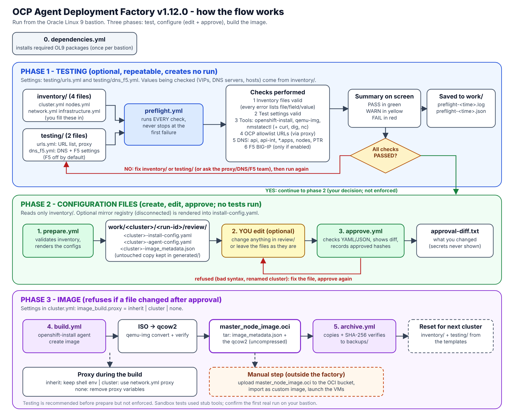

# Deployment workflow: three phases and a mandatory approval gate

The flow has three separate phases. Each phase has its own playbooks, and none of them depends on running the previous one (the approval gate is the only enforced order).

**Setup (once per bastion).** `playbooks/dependencies.yml` installs the required Oracle Linux 9 packages (it also runs at the start of `prepare` and `build`). Optional diagnostic tools (`curl`, `dig`, `nc`, ...) are tolerated when missing, because the checks fall back to built-in Python clients ([TOOLS_AND_FALLBACKS.md](TOOLS_AND_FALLBACKS.md)).

## Phase 1 - Testing (optional, repeatable, creates no run)

`playbooks/preflight.yml` runs every check without stopping at the first failure (inventory, tools, URLs or the mirror registry, DNS, optional F5) and prints a PASSED/WARNINGS/FAILED summary, saved in `work/preflight-<time>.log`. `playbooks/netcheck.yml` runs only the DNS/F5 part. Settings live in `testing/`. See [PREFLIGHT.md](PREFLIGHT.md) and [NETWORK_VALIDATION.md](NETWORK_VALIDATION.md). `prepare` does not require a passing preflight.

## Phase 2 - Configuration files: create, edit, approve

1. **Prepare**: `playbooks/prepare.yml` validates the inventory (no connectivity tests), expands `nodes.yml` (shared `node_defaults` plus per-host `name`/`ip`/`mac`), validates the hosts, the networks (no overlaps, valid `host_prefix`, node IPs inside the machine network), the optional proxy block and the optional mirror block, and **creates** `install-config.yaml`, `agent-config.yaml` and `image_metadata.json` in `work/<cluster>/<run-id>/review/` (cluster-prefixed names). An untouched copy is kept in `generated/`. No ISO is created.
2. **Edit (optional)**: open the files in `review/` and change anything you need (for example a different MTU, an extra `additionalNTPSources` entry, `imageContentSources`). Edit only `review/`, never `installer/`. You can also leave them as generated.
3. **Approve**: `playbooks/approve.yml -e run_id=<run-id>` checks the inventory has not changed, checks that every file still parses and keeps the essentials (valid YAML/JSON; `metadata.name` unchanged; `kind: AgentConfig`, `rendezvousIP` and `hosts` present; `baseDomain`, `networking` and `pullSecret` present), copies the final files to `installer/`, and records the SHA-256 of what you approved. If you edited anything it prints a diff (secrets never shown) and saves it as `approval-diff.txt`. A file that fails the checks is refused and you can fix it and run approve again.

Editing after approval invalidates it: `build` refuses and you approve again. These checks are not a full validation of your edits; the installer remains the final judge.

## Phase 3 - Image build (ISO, qcow2, master_node_image.oci)

`playbooks/build.yml` verifies the approval, checks `openshift-install` and its version, applies the **image-build proxy mode** from `cluster.image_build.proxy` (`inherit`, `cluster` or `none`), creates the ISO (honouring `cluster.release_image`; `cluster.minimal_iso: true` makes it a smaller ISO without the rootfs), converts it to QCOW2, packs the QCOW2 and the approved `image_metadata.json` into `artifacts/master_node_image.oci`, and verifies the QCOW2 format and the archive contents. A failed build can be retried: the installer inputs are restored from the approved review files.

## After the build

**Archive**: `playbooks/archive.yml` copies the inventory, the generated and approved files, the approval diff, the newest preflight log, ISO, QCOW2 and `master_node_image.oci` into `backups/<cluster>/<run-id>/`, verifies checksums, then resets `inventory/` and `testing/` from clean templates. Upload `master_node_image.oci` to your OCI bucket manually. For the next cluster populate the fresh inventory and repeat.

To reject a prepared run, use `playbooks/discard.yml -e run_id=<run-id>` and prepare again.

**Implementation boundaries:** The workflow supports one active run per checkout. OCI-side readiness (NSGs, routes, node-subnet DNS views) and OCI image bootability are not automated; the bastion tests are, but only from the bastion's point of view. Consult [OPERATIONS.md](OPERATIONS.md) for exact commands.
